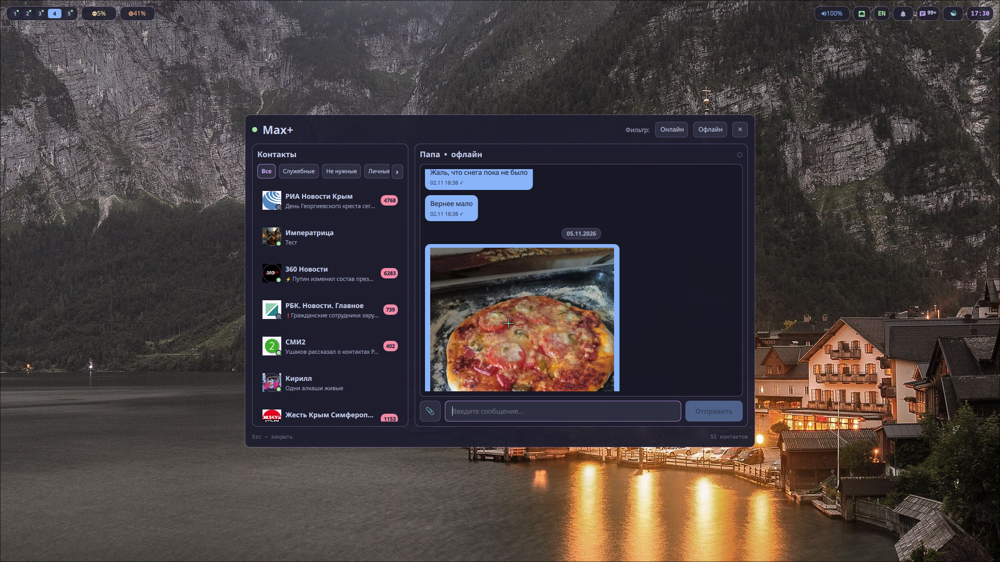

# rumax / Max+




Rust-клиент и инструменты для работы с [Max Messenger](https://max.ru).

Репозиторий содержит:

- **`rumax`** — Rust-библиотека/клиент для Max API (WebSocket, auth, messaging, files, chats).
- **`maxplus-daemon/`** — фоновый демон на Rust: реальная авторизация Max, D-Bus API, локальный кэш SQLite, опциональный TUI.
- **`maxplus-widget/`** — QML/Rust виджет для Quickshell, работающий через D-Bus демона.

> Репозиторий находится в активной разработке. Часть функций и протокольных сценариев может быть неполной.

## Возможности

- Авторизация через реальный mobile-auth flow Max (SMS-код, при необходимости cloud password).
- Фоновый D-Bus сервис `org.maxplus.Client` для UI-клиентов.
- Локальный кэш чатов/сообщений в SQLite (`~/.maxplus/maxplus.db`).
- Получение чатов, истории сообщений, отправка текста/файлов, отметка прочтения, typing-индикатор, папки чатов.
- Интеграция с Quickshell-панелью (Max+ виджет рядом с системными элементами).

## Структура репозитория

```text
.
├── src/                  # rumax library
├── examples/             # примеры использования rumax
├── maxplus-daemon/       # D-Bus daemon + cache + CLI/TUI
├── maxplus-widget/       # Quickshell/QML widget
├── Cargo.toml
└── README.md
```

## Требования

- Linux (тестировалось на Wayland/Hyprland).
- Rust stable + Cargo.
- D-Bus session bus (`busctl --user ...`).
- Для виджета: [Quickshell](https://quickshell.outfoxxed.me/) и рабочая QML-конфигурация.
- Для отправки файлов через picker в QML: `kdialog` (опционально).

## Сборка

Библиотека/примеры rumax:

```bash
cargo build
cargo test
```

Демон:

```bash
cd maxplus-daemon
cargo build
cargo test
```

Виджет (Rust-часть, если используется):

```bash
cd maxplus-widget
cargo build
```

## Запуск демона

Все команды ниже выполняются из `maxplus-daemon/` или через собранный бинарник `maxplus-daemon`.

### 1. Проверить статус

```bash
cd maxplus-daemon
cargo run -- status
```

### 2. Авторизация

Демон использует реальный auth flow Max. Пароль сам по себе не считается успешным входом. Токены/состояние сохраняются локально; пароль не хранится.

```bash
# запрос SMS-кода
cargo run -- auth start +7XXXXXXXXXX

# подтверждение SMS-кода
cargo run -- auth code 123456

# только если Max запросил cloud password
cargo run -- auth password "<cloud-password>"
```

Проверка:

```bash
cargo run -- status
```

Выход:

```bash
cargo run -- auth logout
```

### 3. Запуск D-Bus сервиса

```bash
cargo run -- serve
```

Сервис регистрируется на session bus как:

- Service: `org.maxplus.Client`
- Path: `/org/maxplus/Client`
- Interface: `org.maxplus.Client`

Быстрая проверка:

```bash
busctl --user --json=short call org.maxplus.Client /org/maxplus/Client org.maxplus.Client Status
busctl --user --json=short call org.maxplus.Client /org/maxplus/Client org.maxplus.Client GetChats
```

## D-Bus API

Каждый метод возвращает один JSON-строку (`s`).

| Метод | Аргументы | Описание |
|---|---|---|
| `Ping` | — | Проверка сервиса. |
| `Status` | — | Статус демона/авторизации/подключения. |
| `GetChats` | — | Список чатов из локального кэша. |
| `GetMessages` | `x chat_id, i limit` | Сообщения чата. Кэш отдаётся сразу; при необходимости выполняется фоновое обновление. |
| `SendMessage` | `x chat_id, s text` | Отправка текстового сообщения. |
| `SendFile` | `x chat_id, s path, s caption` | Отправка файла/фото (локальный путь). |
| `MarkRead` | `x chat_id` | Отметить чат прочитанным. |
| `GetUnreadCount` | — | Количество непрочитанных. |
| `GetTyping` | `x chat_id` | Текущий typing-статус по чату. |
| `GetFolders` | — | Папки/фильтры чатов Max. |

Примеры:

```bash
# статус
busctl --user --json=short call org.maxplus.Client /org/maxplus/Client org.maxplus.Client Status

# последние 50 сообщений
busctl --user --json=short call org.maxplus.Client /org/maxplus/Client org.maxplus.Client GetMessages xi -- 123456789 50

# отправить текст
busctl --user --json=short call org.maxplus.Client /org/maxplus/Client org.maxplus.Client SendMessage xs -- 123456789 "Привет"

# отправить файл
busctl --user --json=short call org.maxplus.Client /org/maxplus/Client org.maxplus.Client SendFile xss -- 123456789 "/path/to/file.jpg" "Подпись"
```

## Quickshell виджет

Виджет Max+ подключается к `org.maxplus.Client` через `busctl --user` и показывает чаты, историю, вложения, unread/badge и typing-индикатор.

### Вариант A: использовать QML из `maxplus-widget/`

В `maxplus-widget/` лежат QML-файлы виджета. Подключите их в свою Quickshell-конфигурацию согласно вашей структуре shell.

### Вариант B: локальная конфигурация пользователя

Если Max+ уже интегрирован в `~/.config/quickshell/`, обычно задействованы:

- `~/.config/quickshell/MaxPlus.qml` — панель Max+.
- `~/.config/quickshell/shell.qml` — кнопка/капсула Max+ рядом с системными элементами.

После изменения QML перезапустите Quickshell:

```bash
pkill -x quickshell; quickshell >/tmp/quickshell.log 2>&1 & disown
```

## Данные и конфигурация

По умолчанию используются пользовательские директории:

- `~/.maxplus-daemon/` — конфигурация/состояние демона (может содержать чувствительные токены).
- `~/.maxplus/maxplus.db` — локальный SQLite-кэш чатов и сообщений.

Не коммитьте эти файлы в git.

## Отладка

Логи демона:

```bash
tail -f /tmp/maxplus-daemon.log
```

Логи Quickshell:

```bash
tail -f /tmp/quickshell.log
```

Проверка D-Bus:

```bash
busctl --user list | grep maxplus
busctl --user --json=short call org.maxplus.Client /org/maxplus/Client org.maxplus.Client Ping
```

## Разработка

```bash
# формат/проверка по ситуации
cargo fmt
cargo check
cargo test

cd maxplus-daemon
cargo fmt
cargo check
cargo test
```

Перед коммитом проверяйте, что в индекс не попали `target/`, локальные БД, токены и конфиги из `~/.maxplus*`.

## Лицензия

См. файлы лицензии в репозитории (если применимо) и условия использования upstream-проекта/форка.
